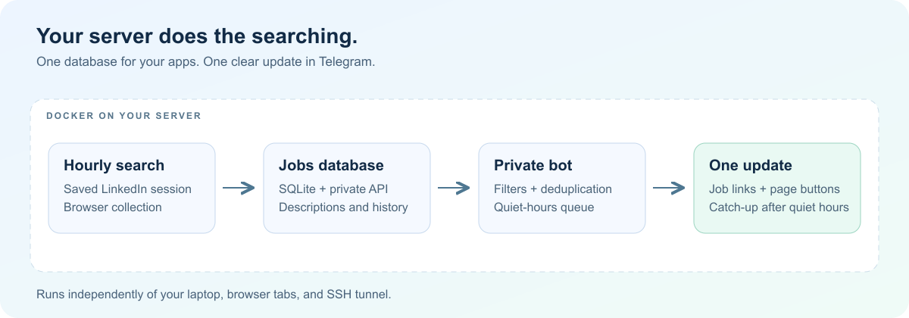
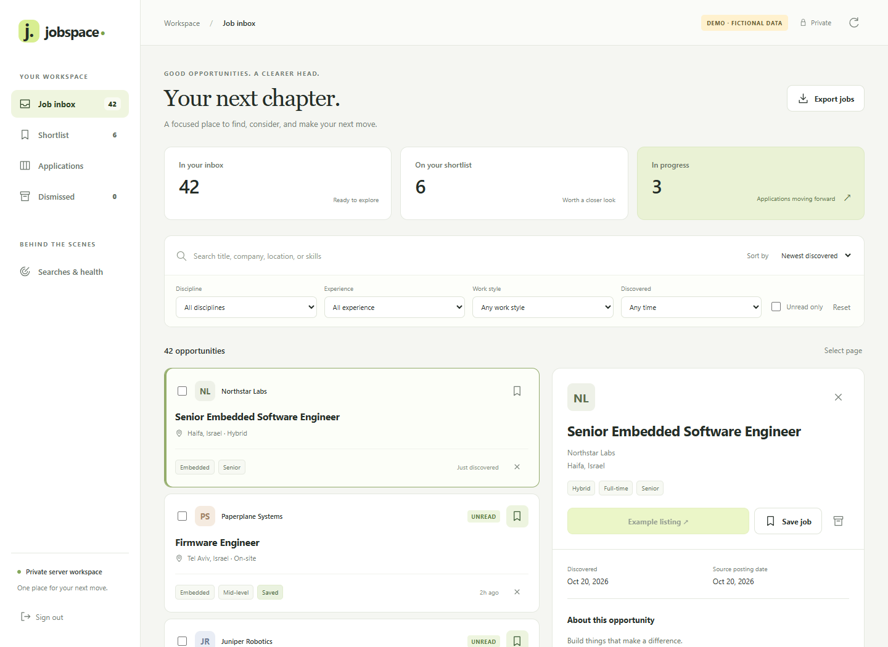
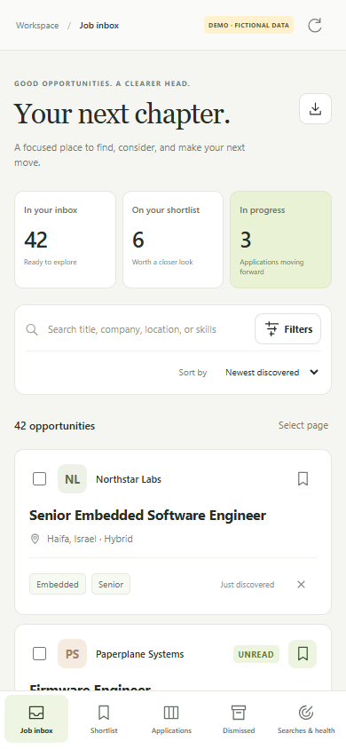
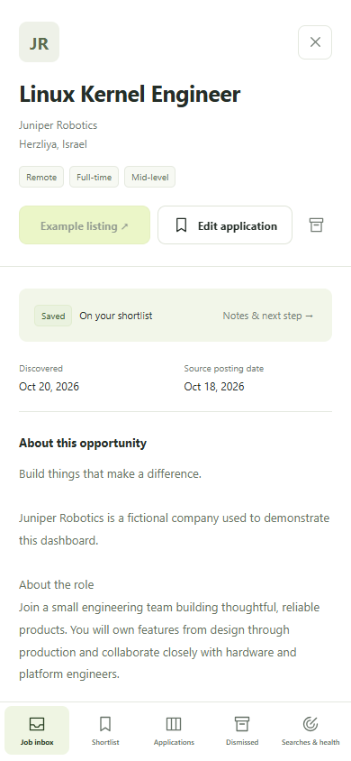
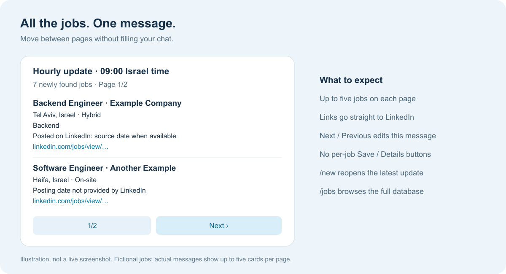
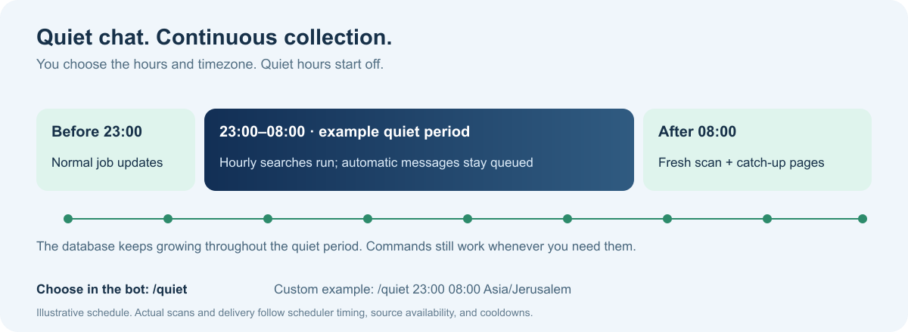

# עוזר לחיפוש משרות — LinkedIn Jobs API ו-Telegram

**עברית · [English and full technical guide](README.md)**

מערכת פרטית על השרת שלך: חיפושי משרות מתוזמנים ב-LinkedIn, מאגר שניתן לחיפוש, ועדכונים ב-Telegram בהודעה אחת עם כפתורי עמודים. המחשב האישי אינו צריך להישאר דולק.



## ממשק אינטרנט פרטי

**Jobspace** פועל בקונטיינר נפרד לצד ה־API והבוט, עם תצוגה מותאמת למחשב ולטלפון.



- חיפוש וסינון לפי תפקיד, ותק, סגנון עבודה, מועד גילוי ומשרות שטרם נקראו.
- הסתרת משרה עם **Dismiss**, ביטול מיידי באמצעות **Undo**, ושחזור מתצוגת **Dismissed**.
- רשימה שמורה, לוח מועמדויות, הערות פרטיות, גרסת קורות חיים ותזכורת למעקב.
- ניהול חיפושים, השהיה והפעלה, איסוף ידני, מצב שירות וייצוא CSV.
- תוכן משרות בעברית ובאנגלית מוצג בכיווניות מתאימה. שפת רכיבי הממשק היא אנגלית.

כל התמונות צולמו במצב הדגמה מבודד: חברות, משרות והערות דמיוניות, ללא מידע אישי או נתוני חשבון.




הממשק מאזין רק ל־`127.0.0.1:8780` בשרת, ונפתח דרך מנהרת SSH. מפתח כניסה נפרד נוצר בקובץ `dashboard-data/access-key`. פרטי ההתחברות ל־API נשארים בשרת. הוראות הפעלה, כניסה, גישה פרטית בטלפון וגיבוי מופיעות ב[מדריך המלא](README.md#web-dashboard).

הערות, שלבי מועמדות ותאריכי מעקב משותפים ל־API ולבוט. הסתרה וסטטוס קריאה שייכים לממשק; סינון ההתראות ושעות השקט עדיין מנוהלים דרך `/preferences` ו־`/quiet`.

## התחלה מהירה בבוט

1. פתחו את הבוט שהגדרתם ולחצו **Start**.
2. לבחירת עברית שלחו `/language he` או `שפה עברית`.
3. בדקו את המערכת באמצעות `/status` או `מצב`.
4. התאימו תפקידים ורמות ותק באמצעות `/preferences` או `העדפות`.
5. להוספת חיפושים השתמשו ב-`/track` או `עקוב`.

לבחירת שפה:

```text
/language he
/language en
/language auto
```

אפשר גם לשלוח `/language` ולבחור בכפתור. במצב אוטומטי השפה נבחרת לפי שפת המשתמש ב-Telegram; ברירת המחדל החלופית היא אנגלית. בחירה מפורשת נשמרת לאחר הפעלה מחדש.

הפקודות באנגלית ממשיכות לעבוד בשתי השפות. שמות הפקודות בתפריט נשארים באנגלית ותיאוריהן מתורגמים, בהתאם ל[מגבלות Telegram על שמות פקודות](https://core.telegram.org/bots/api#botcommand). אפשר להקליד גם את הכינויים בעברית כטקסט רגיל.

## הודעה אחת עם עמודים



בתמונה מוצגות משרות דמיוניות לצורך המחשה. עדכון אמיתי כולל עד חמש משרות בעמוד. כפתורי הבא והקודם מעדכנים את אותה הודעה. קישורי המשרות מובילים ל-LinkedIn.

`/new` פותח מחדש את העדכון האחרון; `/jobs` מחפש במאגר כולו. משרות שסוננו מההתראות עדיין זמינות במאגר. משרות שכבר נשלחו אינן נשלחות שוב לפי אותו מזהה משרה, גם כשהן מתאימות לכמה חיפושים.

״חדשה״ פירושה משרה שהתגלתה למערכת כעת, ולא בהכרח משרה שפורסמה בשעה האחרונה. תוכן המקור נשמר כפי שהוא: כותרות, חברות, תיאורים וקישורים אינם מתורגמים. שדות המקור בכרטיסים בעברית מופרדים לצורך תצוגה תקינה של עברית ואנגלית יחד.

## הגדרות בהודעה אחת

```text
העדפות תפקידים משובצת,תוכנה,בדיקות,אחר; רמות ביניים,בכיר; אזור ישראל; גיל 72; לא_ידוע שמור; כלול נקה; החרג פרונטאנד,פול סטאק,מפתח אתרים,שיווק,מנהל מוצר,תמיכה טכנית
```

או באמצעות הפקודה המקורית:

```text
/preferences roles embedded,software,qa,other; levels mid,senior; region israel; age 72; unknown keep; include clear; exclude frontend,full stack,web developer,marketing,product manager,technical support
```

אפשר להפריד הגדרות בנקודה-פסיק או בשורות חדשות באותה הודעה. כל ההגדרות נבדקות לפני השמירה; אם אחת אינה תקינה או מופיעה פעמיים, דבר לא משתנה.

| הגדרה | דוגמאות |
| --- | --- |
| תפקידים / `roles` | תוכנה, משובצת, בדיקות, אחר; אפשר גם את כל הערכים באנגלית |
| רמות / `levels` | מתמחה, זוטר, ביניים, בכיר, מוביל, פרינסיפל, הכל |
| אזור / `region` | ישראל או רחב |
| גיל / `age` | 1–168 שעות, כאשר יש במקור מידע שמאפשר לקבוע את גיל הפרסום |
| לא_ידוע / `unknown` | שמור או הסתר, עבור רמת ותק לא ידועה |
| כלול / `include` | רשימת מילים או ביטויים בכותרת; נקה לביטול הכלל |
| החרג / `exclude` | מילים או ביטויים להחרגה; נקה לביטול הכלל |

למונחים נפוצים כגון frontend, backend, full stack, web developer, marketing, product manager, technical support ו-Python יש מקבילות בעברית הנבדקות בשני הכיוונים. מילות סינון אחרות נבדקות כביטוי מילולי, ללא תרגום אוטומטי חופשי.

הסיווג מזהה גם כותרות כגון ״מהנדס קושחה בכיר״, ״מהנדסת תוכנה משובצת״, ״מפתח ליבת לינוקס״ ו״בודקת תוכנה״. סינון המיקום הישראלי דורש ציון מפורש של ישראל במיקום. רמות ותק ותפקידים הם סיווג המבוסס על כותרת ונתוני המקור, ולא ציון התאמה לקורות חיים.

## הוספת כמה חיפושים יחד

שלחו את כל השורות הבאות **בהודעה אחת**:

```text
עקוב מהנדס תוכנה משובצת | ישראל
עקוב מהנדס קושחה | ישראל
עקוב Embedded Linux Engineer | Israel
עקוב Linux Kernel Engineer | Israel
עקוב Device Driver Engineer | Israel
עקוב BSP Engineer | Israel
```

מתקבל אישור אחד. אפשר גם להדביק כמה שורות `/track` באנגלית. המערכת בודקת את כל הרשימה לפני יצירת החיפושים, משתמשת בחיפוש קיים במקום ליצור כפילות, ושומרת על זמני האיסוף והשהיות שכבר הוגדרו. עברית ואנגלית הן מחרוזות חיפוש שונות; המערכת אינה מאחדת תרגומים או מוסיפה חיפושים בשפה אחרת בעצמה.

אפשר לשמור עד 20 חיפושים. החיפושים השעתיים עוברים דרך המתזמן והגבלת הקצב של השרת; הם אינם מבוצעים כולם במקביל.

## שעות שקטות



```text
/quiet
/quiet 23:00 08:00
/quiet 23:00 08:00 Europe/London
/quiet off
```

אפשר גם `שקט 23:00 08:00` או `שקט כיבוי`. השעות כבויות עד לבחירת המשתמש. ברירת המחדל לאזור הזמן היא `Asia/Jerusalem`; אפשר לבחור אזור אחר. שעת ההתחלה נכללת בחלון ושעת הסיום אינה נכללת. שינויי שעון קיץ מטופלים לפי אזור הזמן שנבחר.

האיסוף ממשיך בזמן השקט. הודעות אוטומטיות ממתינות, בעוד פקודות וכפתורי עמודים נשארים זמינים. לאחר סיום השקט נעשה ניסיון לאיסוף עדכני, והמשרות הממתינות נשלחות בעדכון השלמה עם עמודים. הגבלות קצב, זמינות המקור ומגבלות הכיסוי עדיין חלות.

`/notify off` משהה הודעות עד לחידוש ידני באמצעות `/notify on`. `/pause מזהה` משהה איסוף של חיפוש מסוים. אלה הגדרות נפרדות משעות שקטות.

## פקודות שימושיות

| פקודה | כינוי בעברית | שימוש |
| --- | --- | --- |
| `/help` | עזרה | כל הפקודות ודוגמאות |
| `/status` | מצב | מצב המערכת והתור |
| `/jobs [מילים]` | משרות | חיפוש במאגר |
| `/new` | חדש | העדכון האחרון |
| `/searches` | חיפושים | מזהי החיפושים וזמני הריצה |
| `/preferences` | העדפות | סינון הפיד |
| `/language` | שפה | בחירת שפת הבוט |
| `/track תפקיד \| מיקום` | עקוב | הוספת חיפוש |
| `/quiet` | שקט | שעות שקטות |
| `/collect מזהה` | אסוף | ניסיון איסוף כעת |
| `/pause מזהה` | השהה | השהיית חיפוש |
| `/resume מזהה` | המשך | חידוש חיפוש |
| `/job מזהה` | משרה | פרטי משרה |
| `/description מזהה` | תיאור | התיאור השמור |
| `/save מזהה` | שמור | מעקב מועמדות |
| `/applications` | מועמדויות | רשימת המועמדויות |
| `/followups` | תזכורות | תזכורות שהגיע זמנן |
| `/alerts` | התראות | תקלות איסוף |

מעקב מועמדות אינו מגיש בקשות ואינו פונה למעסיקים. קיימות גם פקודות `/setsearch`, `/refresh`, `/stage` ו-`/notify`; לרשימה המלאה של 23 הפקודות השתמשו ב-`/help`.

## התקנה ותחזוקה

ההוראות המלאות, Docker Compose, מבנה הקבצים, דוגמאות API, גיבויים ובדיקות נמצאים ב-[README באנגלית](README.md#install-on-a-new-server).

המערכת דורשת שרת Linux, Docker עם Compose, Python 3 וגישת SSH. סקריפט `setup_bot.py` מבקש מזהה Telegram וטוקן בהקלדה מוסתרת. ההתחברות ל-LinkedIn מתבצעת בדפדפן מרוחק דרך מנהרת SSH, והמשתמש משלים בעצמו כל אימות נדרש. נשמרת עוגיית התחברות ולא הסיסמה.

API המשרות דורש `X-API-Key`. השירותים נגישים בשרת דרך loopback; אין צורך לפתוח פורט Telegram ציבורי. גיבויי SQLite יומיים נשמרים בנפרד עבור המשרות והבוט, עד שבעה צילומים לכל מאגר. פרטי גישה וסשן ההתחברות אינם נכללים בגיבויי המאגרים.

## מגבלות ושמירה על פרטיות

זוהי אינטגרציית דפדפן אישית ולא API רשמי לחיפוש משרות של LinkedIn. פקיעת התחברות, שינויי מבנה האתר ומגבלות עמודים עשויים לצמצם את הכיסוי. אין עקיפה של אימות או הגבלות גישה.

אין לפרסם טוקנים, מפתחות API, עוגיות סשן, מאגרים, לוגים או הערות מועמדות. קוד המקור הציבורי אינו מכיל את נתוני ההתקנה הפרטית. GitHub Actions מריץ בדיקות וסריקת סודות בשינויים לקוד.


### ניווט ועדכונים מרוכזים

המשרות מוצגות בכרטיסים קצרים. לחיצה על כותרת פותחת את LinkedIn; הכרטיס כולל חברה, עיר, תפקיד, ותק כשידוע ותאריך כשזמין.
כפתורי הקטגוריות מסננים את אותו עדכון. לחיצה על מונה העמודים פותחת בחירת עמוד; « ו־» עוברים לעמוד הראשון והאחרון. כל הניווט מתבצע באותה הודעה.

תוצאות מכל החיפושים נאספות לעדכון מרוכז בגבול השעה הבא. בבדיקה הראשונה, בסיום שעות שקט ובניסיון חוזר אחרי כשל, ייתכן משלוח מיידי. שעה ללא התאמות נשארת שקטה. זמן העדכון הבא מופיע ב־`/status`. תקלות שגרתיות ברענון תיאורים מוצגות ב־`/status` וב־`/alerts`.

קטגוריית `other` כוללת כברירת מחדל רק תפקידי הנדסה קרובים, כגון אלקטרוניקה, מערכות ואינטגרציה. כדי לקבל כל כותרת לא מסווגת: `/preferences other_scope all`. לחזרה לסינון הטכני: `/preferences other_scope technical`. בחירת `roles all` ממשיכה לכלול את כל הקטגוריות.
פתיחת עדכון ישן מחילה את ההעדפות הנוכחיות ומציינת אם הוסתרו משרות מהעדכון המקורי. תאריך שלא סופק נשאר לא ידוע.
