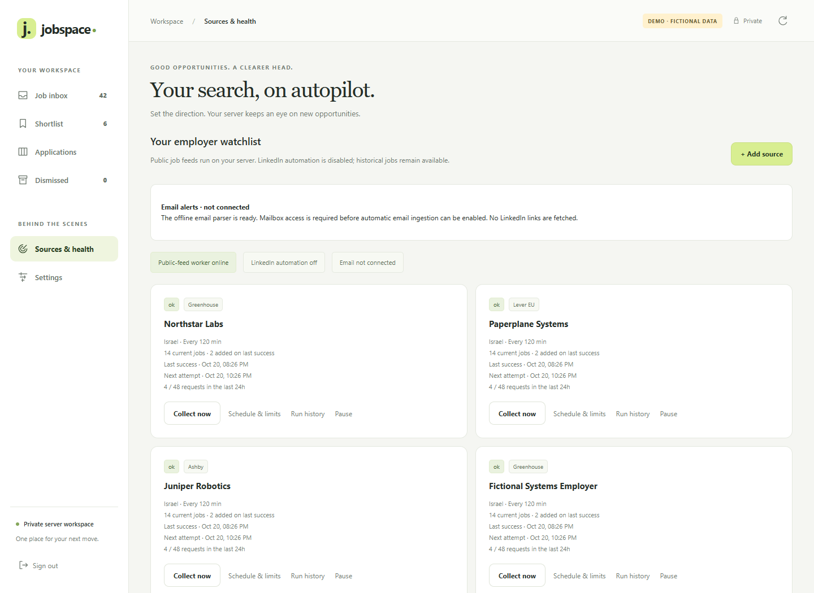
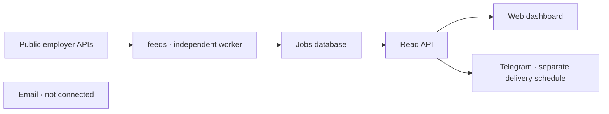
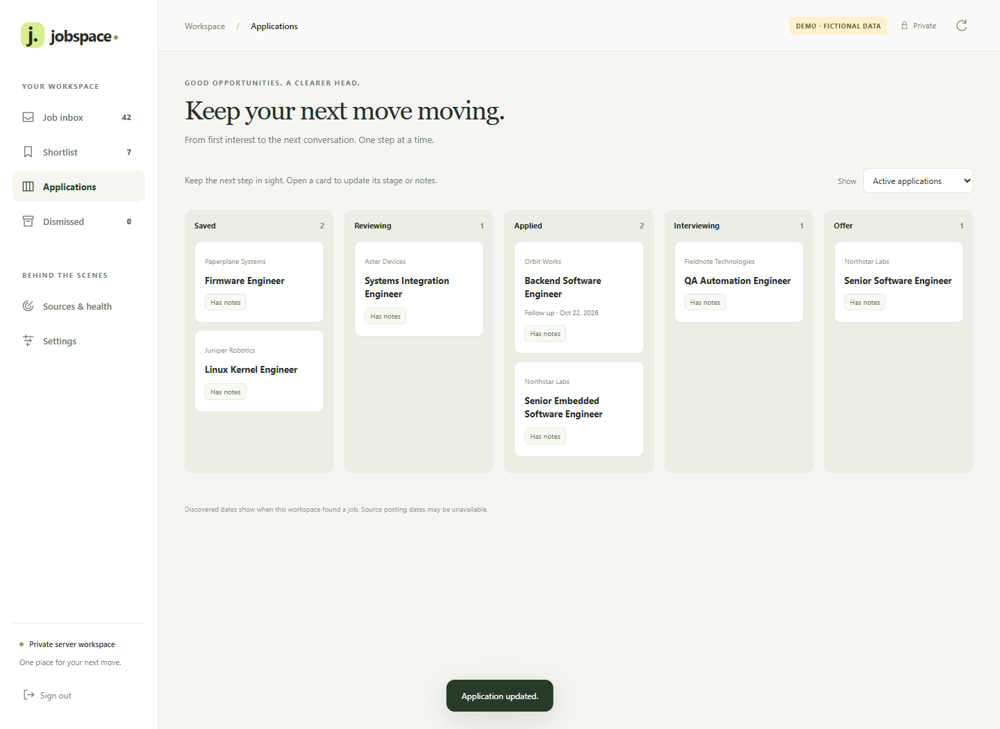
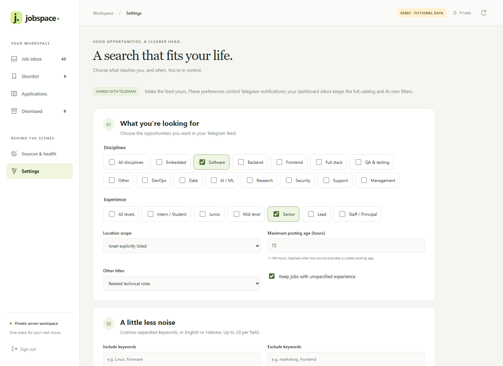
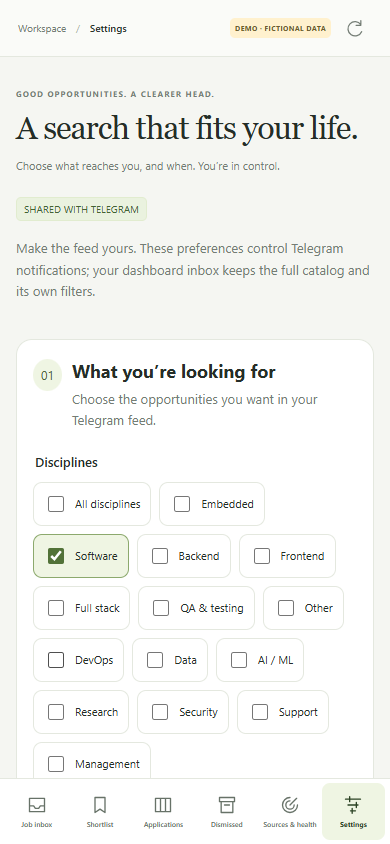
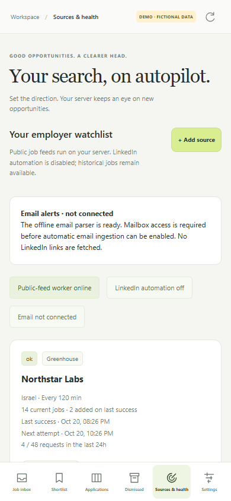

<p align="center">
  
</p>

# Jobspace · Employer Feeds & Telegram Assistant

**English · [עברית](README.he.md)**

[](https://github.com/Uriel1010/linkedin-jobs-assistant/actions/workflows/checks.yml)

Your private, server-hosted job-search workspace. Collect published jobs from documented Greenhouse, Lever (global/EU), and Ashby employer feeds, keep them in a database, and receive new matches in Telegram. A mobile-friendly dashboard provides an inbox, shortlist, application board, and source controls.

**LinkedIn browser automation is disabled by default.** The API runs without a browser; a separate `feeds` container collects public employer boards. Stored LinkedIn jobs remain accessible, but neither scheduled nor manual collection uses your LinkedIn account. Email ingestion is not connected; its offline preview parser is ready for a future mailbox integration.




[Web dashboard](#web-dashboard) · [Bot guide](#use-the-bot) · [Quiet hours](#quiet-hours-and-catch-up) · [Installation](#install-on-a-new-server) · [API](#connect-another-app) · [Troubleshooting](#troubleshooting)



## Features

| Feature | What you get |
| --- | --- |
| Private web dashboard | Responsive inbox, dismiss/restore, shortlist, application board, search controls and CSV export in a separate container. |
| Employer watchlist | Independent source schedules, request budgets, conditional caching, and manual block recovery. |
| New-job alerts | Job-ID deduplication across searches and service restarts. |
| One message per update | Compact linked titles, category tabs and page jumping; navigation edits the same message. |
| Quiet hours | Your schedule and timezone, continued collection, and a paginated catch-up afterward. |
| Feed preferences | Roles, seniority, location rules, title keywords and posting-age limits. |
| Searchable database | Browse in Telegram or connect another app through the authenticated API. |
| Stored descriptions | Descriptions supplied by employer feeds, without per-job LinkedIn enrichment. |
| Application tracker | Stages, notes, contacts, CV references and follow-up dates. |
| Operations | Source history, partial-coverage errors, health checks and database backups. |
| Hebrew and English | Localized replies, buttons, menus and profile descriptions; original job content and links are preserved. |
| Bot profile and menu | Profile image, descriptions and the available commands registered at startup. |

The running services use documented public employer APIs. LinkedIn session-based collection is disabled. See [source limitations](#source-limitations).

## Web dashboard

**Jobspace** runs in its own Docker container, alongside the API, public-feed worker, and Telegram bot.


The screenshots are real captures of the included **demo mode**. All companies, jobs, application notes, and counts are fictional. No account data, credentials, personal details, or production database records are used.

### Review, shortlist, and follow through

- Search titles, companies, locations and descriptions. Filter by discipline, experience, work style, discovery window, or unread status.
- Open a job in the desktop detail pane or mobile full-screen view. Source text supports Hebrew and mixed-direction content.
- **Dismiss** jobs individually or in a selection. Use the 15-second **Undo** action, or restore them later from **Dismissed**.
- **Save** opportunities to your shortlist. Track Saved → Reviewing → Applied → Interviewing → Offer, with rejected, withdrawn and archived stages available too.
- Add private notes, a CV reference and a follow-up date. Applications and reminders use the same API database as Telegram.
- Manage collection searches, pause/resume them, request a run, and review service notices.
- Export the current filtered results as CSV. Spreadsheet formula prefixes are neutralized.

Dashboard dismiss/read state is persistent in its own database. Dismissing a job hides it from the dashboard inbox; the source record stays in the API database. Telegram continues to use its own feed preferences and delivery ledger. Dashboard filters are independent of Telegram `/preferences`. Open **Settings** to edit the shared Telegram feed preferences and quiet hours, or continue using `/preferences` and `/quiet` in Telegram.




### Settings

**Telegram job notification interval:** set 15–1440 minutes in Settings, or send `/interval 120` to the bot for two-hour digests. `/interval` shows the current value; `/interval 60` restores the hourly default. Hebrew alias: `/תדירות 120`. Changing the interval schedules the next digest from the time of the change and preserves queued jobs. It does not change search collection schedules. Quiet-hour catch-up can deliver sooner; important alerts and follow-up reminders keep their minute-by-minute checks.

Open **Settings** in the sidebar or mobile navigation. Choose disciplines, experience levels, location scope, posting-age limit, and include/exclude keywords (English or Hebrew). Control notification delivery and configure quiet hours with a timezone. Click **Save changes** to apply them to the bot on its next check.

Collection continues during quiet hours; the existing catch-up flow scans again and covers the quiet period. Dashboard inbox filters remain independent of Telegram feed filters. Previously filtered jobs are reconsidered; already-sent jobs are not replayed.

Unsaved edits are marked. If Telegram or another tab changes settings while you edit, saving is blocked until you reload, avoiding accidental overwrites. The first notification setup still requires `/notify on` in Telegram to establish the historical baseline.

The dashboard mounts `./bot-data/state` to share the bot's SQLite settings. It does not mount the bot token configuration. Keep both services on the same host; SQLite coordinates their writes. If settings are unavailable, check that the bot has initialized and the state volume is mounted.




### Start the private dashboard

After the API is configured:

```bash
cd ~/Project/linkedin-jobs-assistant
mkdir -p dashboard-data
chmod 700 dashboard-data
docker compose up -d --build dashboard
docker compose ps
```

Compose binds the dashboard to **127.0.0.1:8780** on the server. It is private by default. The dashboard reads the upstream API key server-side; that key is never sent to the browser.

From your computer, keep this SSH tunnel open:

```bash
ssh -N -L 8780:127.0.0.1:8780 user@your-server
```

Open [http://127.0.0.1:8780](http://127.0.0.1:8780). Retrieve the separately generated dashboard access key in your own server terminal:

```bash
cat ~/Project/linkedin-jobs-assistant/dashboard-data/access-key
```

Enter it on the sign-in screen. The browser receives an HttpOnly, SameSite session cookie valid for seven days; the access key is not saved in browser storage. Sign out revokes that session. Login attempts are rate-limited, and state-changing requests require same-origin protection.

For private access on a phone, use an SSH client with local port forwarding or a trusted VPN route. `localhost` on a phone is the phone itself, so a computer's tunnel does not automatically provide phone access. For future internet access, put an authenticated HTTPS reverse proxy in front of the loopback service and set `DASHBOARD_SECURE_COOKIE=1`. Do not expose the HTTP container port directly.

The `dashboard-data/` volume preserves dismiss/read state and sessions across container restarts. Daily consistent database snapshots are kept in `dashboard-data/backups/`, retaining seven snapshots. Applications and notes are backed up with the API database. The container runs without root, with a read-only filesystem, dropped capabilities, and memory/CPU limits.

### Reproduce the sanitized screenshots

The browser tests launch their own isolated demo server using temporary state and built-in fictional records. They never connect to the production API. In the development test environment with Playwright Chromium installed:

```bash
DASHBOARD_SCREENSHOTS=docs/images python -m unittest test_dashboard_browser -v
```

`DASHBOARD_BROWSER_PATH` can point to a locally installed Chromium browser. Do not set `DASHBOARD_DEMO=1` on the production service: demo mode intentionally uses fictional data and skips sign-in. It belongs only in a separate, temporary loopback preview.




## Use the bot

Open the Telegram bot you configured. It accepts only its configured owner in a private chat.

1. Open the bot and press **Start**.
2. Open **Menu** for the command list.
3. Run `/status` to check collection and delivery.
4. Choose your roles and seniority with `/preferences`.
5. Choose `/quiet` if you want quiet hours. They stay **off until you select them**.

New installations start without employer boards. Add them in **Sources & health** using the installation guide. No LinkedIn login is required.

### Read an update


The image is an illustration with fictional jobs, not a live screenshot.


- Click a **job title** to open the original listing (employer board or historical LinkedIn link). Each compact card shows company, city, role, seniority when known, and posting date when available.
- Click **Next** / **Previous**, **«** / **»** for first/last, or the **page counter** to choose a page. Category tabs narrow the same update to Embedded, Software, QA, or other matching groups.
- `/new` reopens the latest delivered update with all its pages.
- `/jobs Python` searches the full database, including jobs excluded from alerts.
- Feed and catalog keyboards contain navigation only. Optional details and tracking are available through commands.

Discoveries from employer sources are combined into one digest at your chosen notification interval. `/interval 120` sets two-hour digests; `/interval 60` restores one hour. Source collection schedules are independent. Quiet-hours catch-up and failed-delivery retries can run before the next scheduled digest. Empty digests are silent. `/status` shows the next digest time.

Older updates use your current preferences when reopened, and show a label when some original jobs are hidden. Category selection changes the count and page numbers for that view.

**“New” means newly discovered by this system.** It does not guarantee publication within the last hour. Cards distinguish known source dates, reposts with an unknown original date, and unavailable dates. Raw source metadata remains available through `/job JOB_ID`. Job IDs are permanently deduplicated; a rare crash after Telegram accepts a message but before its ID is saved can repeat that update.

### Hebrew and English

```text
/language he
/language en
/language auto
```

`/language` opens the language chooser. The default is automatic: Telegram's `he`/`iw` language selects Hebrew and English is the fallback. Explicit choices override detection and survive restarts. Hebrew command aliases also work as plain text, for example `עזרה`, `מצב`, `משרות`, `העדפות`, `שקט`, `שפה עברית`, `עקוב` and `חיפושים`.

```text
עקוב מהנדס קושחה | ישראל
עקוב מהנדס תוכנה משובצת | ישראל

העדפות תפקידים משובצת,תוכנה,בדיקות,אחר; רמות ביניים,בכיר; אזור ישראל; גיל 72; לא_ידוע שמור; כלול נקה
```

Canonical English commands remain available in both languages. Telegram slash-command names remain ASCII, with localized menu descriptions. Query text, job titles, company names, descriptions and URLs are not translated or rewritten. Hebrew feed cards isolate mixed-direction source fields for readability; changing language does not resend jobs or reset page bindings.

The classifier supports Hebrew software, embedded, firmware, kernel, driver, QA and other common titles, Hebrew seniority, and Israel locations explicitly containing `ישראל`. Posting-age parsing supports labels such as `לפני 3 שעות`, `לפני שעה` and `לפני יומיים`; Hebrew repost labels preserve the distinction from original publication time.

Common keyword equivalents work in both directions for frontend, backend, full stack, web developer, marketing, product manager, technical support and Python. Other custom keywords remain literal, whole-phrase matches; this is not automatic translation of arbitrary job content.

### Personalize your feed

Apply several settings in one Telegram command, separated by semicolons:

```text
/preferences roles embedded,software,qa,other; levels mid,senior; region israel; age 72; unknown keep; include clear; exclude frontend,full stack,web developer,marketing,product manager,technical support
```

You can also put each setting on a new line in the same message after `/preferences`, or paste several existing `/preferences …` lines together. The bot validates every setting before saving anything and replies with one summary. If any setting is invalid or repeated, nothing changes. Commas separate list items; spaces within phrases such as `full stack` and `technical support` are preserved.

Open `/preferences` for buttons, or enter:

```text
/preferences roles backend,frontend
/preferences levels senior,lead
/preferences region israel
/preferences include python,backend
/preferences exclude java
/preferences age 48
/preferences unknown hide
```

| Setting | Options |
| --- | --- |
| `roles` | `software`, `backend`, `frontend`, `fullstack`, `data`, `devops`, `ml`, `security`, `embedded`, `qa`, `support`, `research`, `management`, `other`, `all` |
| `levels` | `intern`, `junior`, `mid`, `senior`, `lead`, `principal`, `all`; Staff titles currently belong to the principal category |
| `region` | `israel` requires Israel explicitly in the location; `broad` removes that location rule |
| `include` | At least one listed word/phrase must match the title; `include clear` removes the rule |
| `exclude` | Hide titles containing any listed word/phrase; `exclude clear` removes the rule |
| `other_scope` | `technical` (default): keep related engineering titles in `other`; `all`: allow every uncategorized title |
| `age` | Maximum posting age, 1–168 hours, when source age can be established |
| `unknown` | `keep` or `hide` for unknown seniority |

Separate multiple selections or keywords with commas. Defaults: software roles, all seniorities, explicit Israel location, a 48-hour freshness limit and unknown seniority kept. `software` includes backend, frontend and full stack. Unknown publication dates are retained and labeled. Selecting `other` keeps related electronics, systems and integration engineering by default, excluding unrelated uncategorized retail, legal or sales titles. Use `/preferences other_scope all` to opt into every uncategorized title; `roles all` also keeps every category. These are title rules, so review your results and refine exclusions as needed.

These are title/location rules, not a CV-based suitability score. Preferences filter notifications; collection searches determine what enters the database. Editing preferences rechecks previously filtered, unsent discoveries. Baseline and already-delivered jobs stay suppressed.

### Manage employer sources

Open **Sources & health** in the dashboard. Add a provider, board name, company label, and optional location substring. A board name comes from its public careers URL:

| Provider | Example careers URL | Board |
| --- | --- | --- |
| Greenhouse | `https://job-boards.greenhouse.io/asteralabs` | `asteralabs` |
| Lever EU | `https://jobs.eu.lever.co/mobileye` | `mobileye` |
| Lever global | `https://jobs.lever.co/COMPANY` | `COMPANY` |
| Ashby | `https://jobs.ashbyhq.com/wayve` | `wayve` |

Defaults are a 120-minute schedule, 48 requests per rolling 24 hours, and 10 requests per collection. Each HTTP page counts toward the budget. The worker also enforces shared per-provider pacing and daily limits. Conditional requests use ETag/Last-Modified when supplied.

- **Collect now** queues work; it does not bypass budgets, cooldowns, or the 15-minute manual refresh floor.
- **Schedule & limits** changes one source independently of Telegram delivery.
- **Pause / Resume** controls collection while keeping stored jobs.
- **Run history** distinguishes success, provider errors, interrupted work, and incomplete pagination.
- Access denial, a missing board, or an unexpected redirect requires manual review and resume. Repeated rate limiting also blocks the source. Retry-After and backoff apply.
- An unexpectedly empty previously populated board is paused for review, rather than automatically closing every vacancy.
- The first successful snapshot establishes a baseline. It fills the dashboard without replaying every existing vacancy as a new alert.

Jobs have provider provenance and stable internal IDs. Exact normalized job/apply URLs can join the same vacancy across sources. Similar company/title text alone never merges records. Jobs missing from a complete nonempty snapshot are marked inactive; saved applications and source records are preserved.

`/sources` shows employer-feed status in Telegram. Legacy `/track`, `/collect`, and LinkedIn description refresh cannot start network collection while LinkedIn is disabled.

### Email integration readiness

No mailbox credentials are required for the running public feeds. `POST /imports/email/preview` accepts a JSON `content` field containing a raw email (maximum 500 KB) and extracts direct LinkedIn job IDs/links **offline**. It neither saves jobs nor follows redirects. Mailbox OAuth/IMAP access, trusted sender validation, and a user-approved mailbox/folder must be configured before an automatic email connector can be deployed. That connector is intentionally not enabled.

### Quiet hours and catch-up


The pictured 23:00–08:00 window is an example. The bot does not choose your hours automatically.

```text
/quiet
/quiet 23:00 08:00
/quiet 23:00 08:00 Europe/London
/quiet off
```

`/quiet` shows preset buttons and your current setting. Custom times use 24-hour `HH:MM` format. The default timezone is `Asia/Jerusalem`; later edits without a timezone keep your selected zone. Overnight and daytime schedules work. Start is inclusive, end is exclusive, and identical start/end times are rejected. Timezone rules handle daylight-saving changes.

During quiet hours, hourly collection continues and discoveries are queued. Automatic job updates, collector alerts and follow-up reminders wait. Your commands and page buttons still work.

When quiet hours end, the bot requests a fresh scan of enabled searches to check the interval since the latest collection, then sends queued matches as **one paginated catch-up update**. Existing cooldowns and source restrictions apply. If the fresh scan is blocked by a cooldown, queued jobs can still be delivered and normal scheduled collection continues. Empty periods do not produce empty job updates.

The queue and quiet-period marker survive restarts. Freshness is checked at discovery time so waiting overnight does not make an otherwise matching job expire.

### Pause notifications or collection

| Control | Collection | Automatic messages | How it resumes |
| --- | --- | --- | --- |
| `/quiet …` | Continues | Wait during your chosen hours | Fresh-scan attempt and catch-up after quiet hours |
| `/notify off` | Continues | Paused until `/notify on` | Pending discoveries remain saved; quiet hours still apply |
| `/pause SEARCH_ID` | Stops for that search | Other searches may still send jobs | `/resume SEARCH_ID` enables that search |

Quiet hours never override a manual `/notify off`.

### All commands

Historical LinkedIn collection commands in this reference are retained for compatibility but disabled in the current deployment. Use `/sources` and the dashboard to manage public employer feeds.

| Command | Purpose |
| --- | --- |
| `/start` | Welcome and shortcuts |
| `/new` | Latest delivered update with page navigation |
| `/jobs [words]` | Browse/search the complete stored catalog |
| `/preferences` | Edit automatic-feed filters |
| `/quiet [START END [TIMEZONE]]` | Choose quiet hours; `/quiet off` disables them |
| `/language [he/en/auto]` | Choose Hebrew, English or Telegram language detection |
| `/status` | Feed health, queue, last/next search and issues |
| `/searches` | Collection searches and IDs |
| `/track TITLE \| LOCATION` | Add an hourly search |
| `/setsearch [ID] TITLE \| LOCATION` | Edit search criteria |
| `/collect [ID]` | Request collection now |
| `/pause [ID]` | Disable a collection search |
| `/resume [ID]` | Enable a collection search |
| `/notify on` or `/notify off` | Resume/pause automatic notifications |
| `/job JOB_ID` | Stored details and description preview |
| `/description JOB_ID` | Full stored description |
| `/refresh JOB_ID` | Fetch or refresh source details |
| `/save JOB_ID` | Add a job to your application tracker |
| `/applications [stage]` | List tracked applications |
| `/stage APP_ID STAGE` | Update application stage |
| `/followups` | Due follow-ups |
| `/alerts` | Collection issues |
| `/help` | Command help |

`JOB_ID` is the numeric LinkedIn job ID in its URL. `APP_ID` is the separate tracker ID returned by `/save`. The menu supplies command names; replace example arguments yourself.

### Track applications

```text
/save 1234567890
/applications
/stage 1 applied
/applications interviewing
/followups
```

Replace sample IDs with your real records. Stages: `saved`, `reviewing`, `applied`, `interviewing`, `offer`, `rejected`, `withdrawn`, `archived`.

The API also edits notes, contacts, CV references and follow-up dates. A CV reference is a label/filename, not a file upload. Due follow-ups generate daily deduplicated reminders when notifications are enabled and outside quiet hours. Tracking never submits applications or contacts employers.

## Install on a new server

This guide uses `~/Project/linkedin-jobs-assistant` as the project directory. **Skip initialization if it already runs.** Use [maintenance](#server-maintenance) for updates.

### 1. Prepare the project

Requirements: Linux, Docker Engine with Compose, Python 3 and SSH access. Containers use UID/GID `1000:1000`; that user must own the project and persistent directories, or adapt the Compose user settings to your server.

Clone the project on your server, then run:

```sh
mkdir -p ~/Project
git clone https://github.com/Uriel1010/linkedin-jobs-assistant.git ~/Project/linkedin-jobs-assistant
cd ~/Project/linkedin-jobs-assistant
mkdir -p data bot-data/state
chmod 700 data bot-data bot-data/state
python3 setup_bot.py
```

The setup script asks for your numeric Telegram user ID and then the bot token at a hidden prompt. Obtain the token from Telegram BotFather. Existing configuration is never overwritten by that script.

Compose creates its own network. If your host has exhausted its default Docker address pools, configure a non-overlapping private subnet for this project.

### 2. Start the API

```sh
docker compose up -d --build api
docker compose ps
```

Startup creates the schema and API key under `data/`. API port `8765` binds only to server loopback. No sign-in desktop or browser service is exposed.

### 3. Start the dashboard and public feeds

```sh
mkdir -p dashboard-data
chmod 700 dashboard-data
docker compose up -d --build feeds dashboard
```

Open the dashboard through SSH as described above. Add employer boards in **Sources & health**. No LinkedIn credentials or browser session is needed. The original browser collector is not used by this deployment.

### 4. Start the bot and baseline existing jobs

On the server:

```sh
docker compose up -d --build bot
docker compose ps
```

In your bot's private Telegram chat:

1. Press **Start**.
2. Add employer sources through the dashboard.
3. Check `/sources` until the first collection succeeds.
4. Run `/notify on`. Its first use silently baselines jobs already stored; later discoveries are eligible for alerts.
5. Choose `/preferences` and, optionally, `/quiet`.

Normal operation needs no laptop, browser tab or SSH tunnel. All four services use `restart: unless-stopped`; enable the Docker service at boot on a new server.

Startup registers the command menu and descriptions and uploads the bundled profile picture when its contents change. Quiet-hour choices are preserved. Run only one polling process per token; startup stops if an existing webhook is detected.

## Connect another app

Read stored jobs through the API while keeping SQLite files private. Inside Compose use `http://api:8765`; on the server use `http://127.0.0.1:8765`.

For a local app or the API docs, open a tunnel from your computer:

```sh
ssh -N -L 8765:127.0.0.1:8765 USER@SERVER
```

Open [interactive API documentation](http://127.0.0.1:8765/docs). Retrieve `data/api-key` privately in your SSH terminal and use **Authorize**. All data routes require `X-API-Key`; `/health` does not.

### Read jobs

Set `JOBS_API_KEY` privately in your app's environment, then:

```sh
curl --fail --silent --show-error \
  -H "X-API-Key: $JOBS_API_KEY" \
  'http://127.0.0.1:8765/catalog?q=python&offset=0&limit=50'
```

`/catalog` returns unique stored jobs and searches title, company and description. Use it to browse or import a snapshot.

For incremental synchronization:

```text
GET /jobs?after_id=0&limit=100
```

Persist the response's `next_after_id` and send it as `after_id` next time. Event IDs may have gaps. A job can match several searches, so deduplicate records by job `id` while advancing the event cursor. An optional `search_id` supports a separate cursor per search.

### API reference

Public-feed endpoints use the same `X-API-Key` authentication:

| Endpoint | Purpose |
| --- | --- |
| `GET /sources` | Provider status, schedules, budgets, worker health |
| `POST /sources` | Add a board (`provider`, `board`, `company`, `location_filter`) |
| `PATCH /sources/{id}` | Update schedule, budgets, enabled state; requires current `revision` |
| `POST /sources/{id}/poll` | Queue a collection, subject to budgets and cooldowns |
| `POST /sources/{id}/resume` | Explicit recovery after reviewing a blocked source |
| `GET /sources/{id}/runs` | Last 20 collection attempts |
| `POST /imports/email/preview` | Offline raw-email preview; does not save jobs or connect a mailbox |


| Method and path | Purpose |
| --- | --- |
| `GET /health` | Unauthenticated health check |
| `GET /status` | Collector, saved-session and network status |
| `GET /overview` | Job counts, application stages and follow-ups |
| `GET /catalog` | Unique jobs; `q`, `offset`, `limit` |
| `GET /jobs` | Discovery events; `after_id`, optional `search_id`, `limit` |
| `GET /jobs/{id}` | Description, metadata and enrichment status |
| `POST /jobs/{id}/refresh` | Fetch source details |
| `GET /searches` | Searches and last/next runs |
| `POST /searches` | Create a search |
| `POST /searches/bulk` | Atomically create/reuse a batch of searches; body `{"searches": [{"keywords": "Firmware Engineer", "location": "Israel"}]}` |
| `PATCH /searches/{id}` | Edit criteria, limits, interval or enabled state |
| `POST /searches/{id}/poll` | Request collection now |
| `DELETE /searches/{id}` | Remove a search and its match history |
| `GET /runs` | Collection history, counts, pages and coverage |
| `GET /alerts` | Unresolved alerts; optional resolved history |
| `POST /alerts/{id}/acknowledge` | Acknowledge an alert |
| `POST /applications` | Track a stored job |
| `GET /applications` | List/filter applications |
| `GET /applications/{id}` | Record with status history |
| `PATCH /applications/{id}` | Edit stage, notes, contacts, CV reference or dates |

Example search body:

```json
{
  "keywords": "Backend Engineer",
  "location": "Israel",
  "remote": false,
  "interval_minutes": 60,
  "max_pages": 8,
  "lookback_hours": 48
}
```

`remote: false` includes all work arrangements; `true` selects remote roles. Supported ranges: interval 30–10,080 minutes, pages 1–12, initial lookback 24–168 hours. New searches are enabled for background collection.

Example application body, using a real stored job ID:

```json
{
  "job_id": "1234567890",
  "status": "saved",
  "notes": "Review with my backend CV",
  "cv_version": "backend-v2.pdf",
  "follow_up_at": "2026-11-01T09:00:00+02:00"
}
```

Dates require a timezone and are stored in UTC. Use JSON `null` to clear optional fields. Search/delivery times are displayed in Israel time; quiet schedules can use another chosen timezone.

## Server maintenance

Run on the server:

```sh
cd ~/Project/linkedin-jobs-assistant
docker compose ps
docker compose logs --tail=50 api
docker compose logs --tail=50 bot
```

After updating source files, rebuild the affected service:

```sh
docker compose up -d --build --no-deps bot
```

For a full update use `docker compose up -d --build`. To stop without deleting persistent data use `docker compose stop`.

### Project files

```text
linkedin-jobs-assistant/
├── app.py                   API routes and scheduler
├── collector.py             Browser collection and enrichment
├── storage.py               Jobs schema and persistence
├── dashboard.py             Private dashboard backend and authentication
├── dashboard_static/        Responsive browser interface
├── Dockerfile.dashboard     Separate dashboard container
├── telegram_bot.py          Commands, quiet hours, delivery and pages
├── feed_ui.py               Compact HTML cards, role tabs and page layout
├── feed_rules.py            Filters and job cards
├── i18n.py                  Hebrew/English UI text and input aliases
├── maintenance.py           Consistent database snapshots
├── connect.py               Temporary sign-in desktop
├── setup_bot.py             Hidden-prompt token setup
├── compose.yaml             API and bot services
├── Dockerfile               Playwright API image
├── Dockerfile.bot           Telegram bot image
├── job-search-profile.jpg   Bot profile asset
├── docs/images/             README illustrations
├── data/                    Private API data; excluded from Git/build context
│   ├── jobs.sqlite3
│   ├── api-key
│   ├── session.json
│   └── backups/
└── bot-data/                Private bot data; excluded from Git/build context
    ├── config.json
    └── state/
        ├── bot.sqlite3
        └── backups/
```

### Backups and recovery

Consistent SQLite snapshots are created daily. Each database retains its latest **seven snapshots**. Jobs/applications are backed up under `data/backups/`; bot preferences, cursor, deliveries and page bindings under `bot-data/state/backups/`.

Database snapshots exclude the API key, bot token and LinkedIn session. Back up those credential files separately and privately for a complete recovery copy. Databases can contain personal application notes and also belong in private storage.

For restoration, stop the affected services, preserve current databases and newer records, then restore the chosen snapshot. Handle SQLite `-wal` and `-shm` sidecars as part of that stopped-database recovery; do not overwrite a running database with an older main file. Restart and check `/status` and `docker compose ps`.

### Credentials and access

| File | Purpose |
| --- | --- |
| `bot-data/config.json` | Bot token and authorized owner ID |
| `data/api-key` | HTTP API authentication |
| `data/session.json` | LinkedIn session; treat as a credential |

Credential files have owner-only permissions. The bot mounts its own writable state and read-only credentials; it does not mount the LinkedIn session or jobs database. API/desktop ports bind to loopback. Telegram uses outbound long polling with no public webhook port. Logs omit private payloads and token-bearing Telegram URLs.

To rotate a token, stop the bot, update its private configuration on the server, then recreate the container. To disconnect LinkedIn, stop the API and remove only the saved session; jobs remain stored. Reconnect before collecting again.

### Tests and automated checks

GitHub Actions runs the full test suite and scans commit history for secrets on pushes and pull requests. It uses fake credentials and temporary databases.

Unit tests use fake credentials, temporary databases and local HTML fixtures. Run with source mounted read-only:

```sh
docker compose run --rm --no-deps \
  -v "$PWD:/tests:ro" --entrypoint python bot \
  -m unittest discover -s /tests -p 'test_bot.py'

docker compose run --rm --no-deps \
  -v "$PWD:/tests:ro" --entrypoint python bot \
  -m unittest discover -s /tests -p 'test_feed_rules.py'

docker compose run --rm --no-deps \
  -v "$PWD:/tests:ro" --entrypoint python bot \
  -m unittest discover -s /tests -p 'test_setup.py'
```

API tests require a test-only dependency:

```sh
docker compose run --rm --no-deps \
  -v "$PWD:/tests:ro" api sh -c \
  'pip install --quiet --target /tmp/testdeps httpx==0.28.1 && PYTHONPATH=/tmp/testdeps:/tests python -m unittest discover -s /tests -p test_app.py'
```

The tests do not use your LinkedIn account or Telegram token. The interactive-desktop test opens a local browser and desktop but mocks external navigation. Keep operational checks that send messages or run real searches separate from unit tests.

## Troubleshooting

| Symptom | Check |
| --- | --- |
| No new messages | `/status`, `/notify on`, quiet hours and enabled searches. No-new-jobs periods are silent; `/jobs` alone does not start collection. |
| Stored jobs missing from alerts | `/preferences`, baseline suppression and previously delivered IDs. `/jobs` browses the unfiltered catalog. |
| Bot does not reply | Press Start in the owner's private chat. Check owner ID and `docker compose ps bot`. Other users/groups are ignored. |
| Quiet schedule looks wrong | `/quiet` shows the selected timezone; server OS timezone does not control it. Check `/notify` too. |
| Catch-up is delayed | Check `/alerts`, API health, network cooldowns and coverage. The fresh scan respects source restrictions. |
| LinkedIn login/collection disabled | Expected: use public employer feeds. Historical jobs remain available. |
| Coverage limited | Narrow criteria or adjust `max_pages` through the API. Review `/runs` and `/alerts`; already stored jobs remain safe. |
| Description pending/unavailable | Enrichment runs between due searches. `/refresh JOB_ID` retries under the global cooldown. |
| Collection returns 409 | Another run, login desktop, session problem or cooldown may block it. Read the response and `/alerts` before retrying. |
| Commands missing from Menu | Restart the updated bot to register commands, then reopen the Telegram chat if its UI is cached. `/language` sets the owner's preferred menu language. |
| Existing webhook blocks startup | Use one integration per token and resolve the old webhook before switching to polling. |
| Local API docs fail | Keep the SSH tunnel open and ensure local port 8765 is free. |

## Source limitations

Public employer APIs cover the boards you explicitly track, not all vacancies on the internet. Location filtering is a case-insensitive substring of provider locations; absent or ambiguous locations may be missed. Publication dates are used only when supplied; modification dates are not substituted. Greenhouse, Lever, and Ashby can still change schemas, limit requests, or become unavailable. Errors preserve the last successful snapshot.

Source blocks never trigger proxy rotation, account switching, or automated verification attempts. LinkedIn automation remains disabled. Email alerts, once connected, will arrive according to the sender's delivery schedule; an hourly Telegram digest cannot make those alerts arrive sooner.

Provider references: [Greenhouse Job Board API](https://docs.greenhouse.io/job-board.html), [Lever Postings API](https://github.com/lever/postings-api), [Ashby Job Postings API](https://developers.ashbyhq.com/docs/public-job-posting-api).

### Independent service controls

```sh
docker compose stop feeds     # stop public collection; database/API/dashboard remain usable
docker compose stop bot       # stop Telegram; collection and dashboard remain usable
docker compose up -d feeds    # resume public feeds
```

The browser-free API performs database maintenance only. Collection runs in `source_worker.py`. The dashboard never needs LinkedIn credentials. Keep `LINKEDIN_COLLECTION_ENABLED=0`; the production API image intentionally does not contain Playwright.

### Migrating an existing installation

Back up `data/jobs.sqlite3` and `bot-data/state/bot.sqlite3` using SQLite's backup API before updating. Stop the old API and bot. Preserve volumes, dashboard access keys, and any private LAN/network configuration when adopting the new Compose services. Archive any old LinkedIn session outside mounted runtime directories, pause historical LinkedIn searches, and start `api`, `feeds`, and `dashboard`. Leave notification delivery paused until source baselines and preferences are reviewed. Database migrations are additive and preserve existing job/application IDs.

## Documentation images

The SVG workflow, feed and quiet-hours images are explanatory illustrations. The profile icon was generated with imagegen and converted to JPEG for Telegram. Its original prompt is in [docs/profile-image-prompt.txt](docs/profile-image-prompt.txt).
